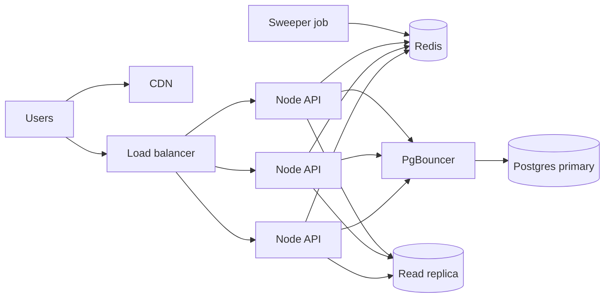

# FlashKart

Backend and a small React page for a flash sale, where a lot of users try to buy limited stock at the same time.

Main goals: no overselling, no duplicate orders, and fast responses under load.

Stack: Node.js + TypeScript + Express, TypeORM + PostgreSQL, Redis (ioredis), React + Vite, Docker Compose.

## How to run

Needs PostgreSQL (13+) and Redis (3.0+) running locally.

```bash
# one time: create the database
psql -U postgres -c "CREATE DATABASE flashkart"

cd backend
cp .env.example .env            # put your postgres password in DATABASE_URL
npm install
npm run seed                    # runs migrations, adds demo users + products
npm run dev                     # API on http://localhost:4000

cd ../frontend
npm install
npm run dev                     # UI on http://localhost:5173
```

`docker compose up -d` is also available if you'd rather run Postgres and Redis in Docker.

Tests (need Postgres and Redis running):

```bash
cd backend
npm test            # unit + integration tests
npm run loadtest    # needs the API running: 500 users hit a product with stock 100
```

Auth is not implemented. The API reads the user id from the `x-user-id` header. In the UI you can switch user with `?user=00000000-0000-4000-8000-000000000002` (seeded users end in 0001, 0002, 0003).

## Folder structure

```
backend/src
  config/        env, TypeORM data source, redis client, logger
  entities/      User, Product, Cart, CartItem, Order
  migrations/    schema migration
  redis/scripts/ lua scripts (reserve, consume, release, complete, unlock)
  modules/       product, cart (reserve), order (checkout)
  jobs/          reservation sweeper
  middleware/    auth stub, zod validation, rate limit, error handler
  scripts/       seed, loadtest
backend/tests    jest tests
frontend/src
  api/           fetch wrapper + endpoints
  hooks/         useCountdown, useSaleStatus, useStockPolling, useReservation
  components/    FlashSalePage, ProductCard, StockBadge, SaleCountdown, AddToCartButton, ReservationTimer
```

## Basic idea

Stock is kept in two places:

- **Postgres `products.stock`** is the real value. It only goes down when an order is placed. There is also a `CHECK (stock >= 0)` constraint.
- **Redis `stock:{productId}`** is the fast counter used when users click "Add to cart". Every reserve goes through Redis, not the database.

So Redis decides who gets a reservation, and Postgres makes the final sale. If Redis ever gets something wrong, the DB still won't let stock go below 0.

## A1 - Entities

- **User**: id, email (unique), name
- **Product**: sku (unique), price (`numeric(12,2)`), stock (check >= 0), max_per_user, sale_starts_at, sale_ends_at, version
- **Cart**: user_id, status `ACTIVE / CHECKED_OUT / EXPIRED`. Only one ACTIVE cart per user (partial unique index).
- **CartItem**: cart_id, product_id, quantity, price_at_reservation, reservation_id (unique), reserved_until, status `RESERVED / RELEASED / CONVERTED`
- **Order**: user_id, product_id, reservation_id (unique), idempotency_key (unique), quantity, unit_price, total_amount, status `PENDING / CONFIRMED / FAILED / CANCELLED`

All ids are UUIDs, and all tables have created_at/updated_at. Indexes: products (sale_starts_at, sale_ends_at), carts (user_id, status), cart_items (product_id, status) and (reserved_until), orders (user_id, created_at).

Assumptions:
- A user can hold only one active reservation per product.
- Max quantity per user comes from `products.max_per_user`.
- A reservation lasts 5 minutes.
- No payment step: a successful checkout creates a CONFIRMED order.
- Price is locked at reservation time.
- Money is never handled as a JS float. It's stored as numeric and calculated in cents with BigInt.

## A2 - Reserve stock: `POST /cart/reserve`

Body: `{ "productId": "...", "quantity": 1 }`. Response 201: `{ reservationId, productId, quantity, unitPrice, status, expiresAt }`.

Steps:
1. Validate the body, check the rate limit (10 req/sec per user), and check the sale is live and the quantity is allowed.
2. Run `reserve.lua` in Redis. In one step it:
   - checks the user doesn't already have a reservation for this product
   - checks `stock >= quantity`
   - decrements the stock
   - saves the reservation hash with a TTL
   - adds it to the `resv:expiry` sorted set (score = expiry time)

   Redis runs a Lua script completely before running any other command, so two users can't both read "1 left" and both buy it.
3. Return the response. The cart_items row is saved to Postgres in the background, so the user doesn't wait on the DB.

**Expiry:** A Redis TTL alone does not return stock. A sweeper job runs every 5 seconds. It picks up expired reservations from the sorted set and runs `release.lua`, which adds the stock back. The release only happens if the reservation is still RESERVED, so running it twice is safe. A small Redis lock makes sure only one server instance runs the sweeper at a time.

If Redis is down, reserve returns 503. It doesn't fall back to selling without the check.

## A3 - Checkout: `POST /order/checkout`

Body: `{ "reservationId": "..." }`. Header: `Idempotency-Key` (required).

Steps:
1. If an order already exists for this key (or for this reservation), return the same order with 200. It's a retry, not an error.
2. `SET idem:{key} PROCESSING NX EX 60` in Redis. If another request with the same key is running, return 409 CHECKOUT_IN_PROGRESS.
3. `consume.lua` changes the reservation from RESERVED to CHECKING_OUT and extends its time, so it can't expire in the middle of checkout.
4. One DB transaction:
   - `UPDATE products SET stock = stock - qty WHERE id = ? AND stock >= qty`. If no row is updated, fail with OUT_OF_STOCK.
   - insert the order (CONFIRMED)
   - mark the cart item CONVERTED and the cart CHECKED_OUT
5. After commit: delete the reservation from Redis (stock stays sold) and store `idem:{key} = orderId` for 24h.
6. If something fails: roll back, return the stock to Redis, delete the idem key so the user can retry, and return the error. Before releasing, the code checks whether the order was actually created. If it was, that order is returned instead.

The unique constraints on `orders.idempotency_key` and `orders.reservation_id` are the real protection. Redis is only the fast check.

Error format: `{ "error": { "code": "OUT_OF_STOCK", "message": "..." } }`

| code | status |
|---|---|
| VALIDATION_ERROR, IDEMPOTENCY_KEY_REQUIRED | 400 |
| UNAUTHORIZED | 401 |
| PRODUCT_NOT_FOUND, RESERVATION_NOT_FOUND | 404 |
| OUT_OF_STOCK, ALREADY_RESERVED, CHECKOUT_IN_PROGRESS, IDEMPOTENCY_KEY_CONFLICT | 409 |
| RESERVATION_EXPIRED | 410 |
| SALE_NOT_ACTIVE, QUANTITY_LIMIT_EXCEEDED | 422 |
| RATE_LIMITED | 429 |
| SERVICE_UNAVAILABLE | 503 |

Other endpoints: `GET /products`, `GET /products/:id`, `GET /products/:id/stock`, `GET /cart/reservations/:id`, `GET /health`.

## B - React page

- No Redux. The state belongs to one page and one product card, so local state and a few hooks are enough. If the app grows, React Query would be the next step.
- **Server time:** every API response includes `serverTime`. The client computes the offset between its clock and the server's, and every countdown uses `Date.now() + offset`, so a wrong device clock doesn't matter.
- `useCountdown` uses one setInterval, cleared on unmount.
- Stock is polled every ~2.5 seconds with a little random jitter. Polling is skipped when the tab is hidden.
- The "Add to cart" button is disabled while a request is pending, when stock is 0, when the sale isn't live, or when the user already has a reservation. A ref guard also blocks fast double clicks.
- When the reservation timer reaches 0, the reservation is cleared, a message is shown, and the button works again.
- The reservation and its idempotency key are saved in sessionStorage. After a refresh the timer continues. If the refresh happened during checkout, checkout continues with the **same key**, so no second order is created.

## C1 - Handling 10k requests/sec

- Static files and the product list are served from a CDN (short cache for the product list).
- A load balancer (ALB) in front of several stateless Node instances, with autoscaling. Scale up before the sale starts, because autoscaling is too slow for a burst.
- Every piece of shared state (stock, reservations, idempotency, rate limits) is in Redis, so any instance can handle any request.
- Reserve is a single Redis Lua call and never touches the DB, and one Redis instance can handle far more than 10k ops/sec. For more, use Redis Cluster with keys tagged by product.
- Postgres only handles checkouts, and there can't be more checkouts than stock. Use PgBouncer / RDS Proxy for connection pooling and a read replica for product reads.
- Rate limiting at WAF level (per IP) and in the app (per user, in Redis).
- Optional: put checkout on a queue (SQS/BullMQ) if a slow step like payment gets added.
- With a huge number of users, stock polling could be replaced with SSE/WebSocket push.



## C2 - Keeping Redis and DB consistent

Expected relation: `redis stock = db stock - stock held in active reservations`.

The two can be briefly out of sync, but only in the safe direction: Redis shows *less* stock, for example when an expired reservation hasn't been swept yet (at most ~5 seconds). And if Redis ever allowed too much, the DB conditional update still blocks it.

Special cases handled in the code:
- **Order committed but the Redis cleanup failed.** The reservation stays CHECKING_OUT. The sweeper finds it, sees the order exists in the DB, and finalizes it without giving the stock back.
- **Checkout was very slow and the sweeper released the reservation, then the order still committed.** `complete.lua` notices this and takes the unit back out of Redis.
- **DB says out of stock but Redis allowed it.** The checkout fails and the stock is returned to Redis.

If Redis goes down: reserves fail (503) until the replica takes over. Redis runs with AOF enabled. On startup, stock is loaded from the DB with `SET NX`, so a live counter is never overwritten.

If Postgres goes down: reserves still work. Checkouts fail and release the stock, and the user can retry with the same key later.

Not built yet: a reconciliation job that compares Redis stock with the DB value every minute and fixes any difference.

## D1 - Stock was 100 but 120 orders got created

Most likely cause: the code read the stock first and decremented it later, e.g. `GET stock`, then `if (stock > 0)`, then `DECR`. Under heavy traffic, many requests read the same value before any of them decrements it. Another possible cause: a reservation expired while its checkout was still running, the stock was given to someone else, and then the slow checkout also completed.

How it's fixed here:
- The check and the decrement happen in one Lua script (atomic).
- The DB update is conditional (`WHERE stock >= qty`), plus the `CHECK (stock >= 0)` constraint.
- Checkout moves the reservation to CHECKING_OUT and extends its time, and the sweeper checks the DB before releasing a stuck checkout.
- On startup, stock is loaded with `SET NX`, so live values aren't overwritten.

To investigate a real incident, I would compare the order count with the starting stock, look at when the extra orders were created (all at sale start points to a race; around the 5-minute mark points to the expiry problem), and check for duplicate reservation_ids.

## D2 - User refreshed during checkout and got 2 orders

Cause: the server couldn't tell a retry from a new order, and the DB had no rule against two orders for one reservation.

Fix:
- The client creates one Idempotency-Key per reservation and saves it in sessionStorage. A refresh or retry sends the same key.
- The server returns the existing order for a key that was already used.
- Redis `SET NX` stops two parallel requests with the same key.
- The reservation state CHECKING_OUT blocks a second checkout even with a different key.
- Unique constraints in the DB on idempotency_key and reservation_id. If a duplicate insert still happens, the code catches the error and returns the existing order.
- The checkout button is disabled while the request is running.

## Test results

`npm test`: 14 tests passing. Some of them:
- 300 users reserve at the same time for 50 items: exactly 50 succeed.
- The same user sends 10 reserve requests at once: only 1 succeeds.
- 5 checkouts at once with the same key: 1 order.
- An expired reservation gives its stock back, and only once.
- When the DB rejects a sale, the stock goes back to Redis.

`npm run loadtest` (500 users, stock 100):
```
Phase 1: 500 concurrent reserves, stock 100
  outcomes: {"201":100,"OUT_OF_STOCK":400}
  PASS  exactly 100 reservations succeeded
  PASS  Redis stock never went below 0
Phase 2: checkout x3 per reservation with the same Idempotency-Key
  outcomes: {"200":100,"201":100,"CHECKOUT_IN_PROGRESS":100}
  PASS  one distinct order per reservation (100)
  PASS  orders in DB = 100
  PASS  DB stock = 0 (never oversold)
  PASS  Redis stock (0) matches DB stock
```

Latency in this local test was high (around 1 second at p50) because Docker Desktop on Windows adds about 1ms to every Redis call. That's a local setup issue, not how it would behave on a server.

## Not done / next steps

- Real authentication (JWT)
- Payment step
- Reconciliation job between Redis and the DB
- An endpoint to cancel a reservation
- SSE/WebSocket for stock updates
- Frontend tests
